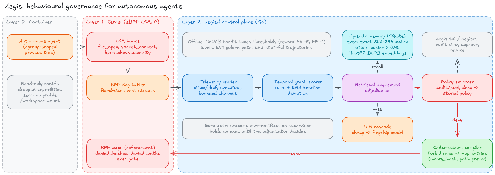
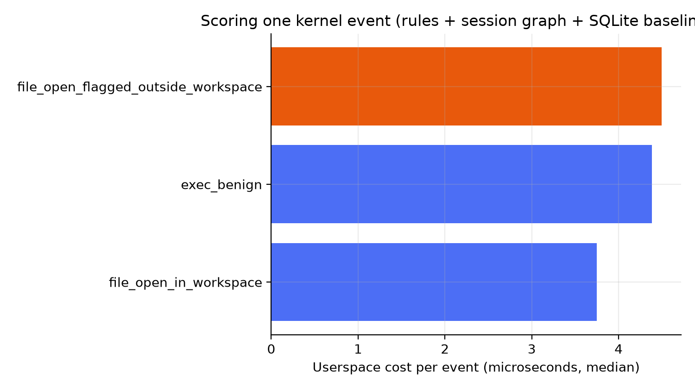
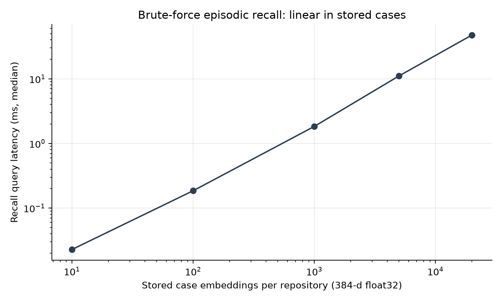
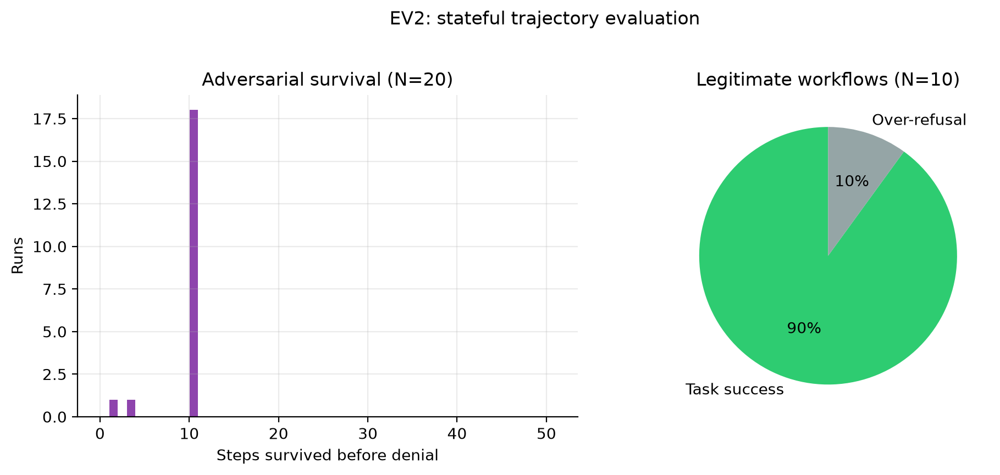

<div align="center">

# Aegis
**Behavioural governance, episodic memory and adaptive policy control for autonomous agents**

[](https://go.dev/)
[](https://ebpf.io/)
[](https://sqlite.org/)

*A zero-trust enforcement boundary for AI coding agents, built as a one-week OpenAI Buildweek proof of concept.*

</div>

> **Platform note.** Aegis is built on eBPF LSM hooks and **runs only on Linux** (kernel >= 5.8 with `CONFIG_BPF_LSM=y` and `lsm=bpf` on the kernel command line). On Windows use WSL2 to build and run the test suite; the kernel enforcement path needs a kernel that exposes BPF-LSM. Evaluate it on a Linux machine or VM.

Static isolation (containers, seccomp, AppArmor) decides each action on its own. An agent that has been prompt-injected can still chain individually permitted actions (for example a sequence of `git worktree` commands) into something harmful. Aegis therefore watches the *sequence* of kernel events an agent produces, scores it against hard zero-trust rules and a learned per-repository baseline, asks an LLM only when it has no precedent, remembers every decision, and turns denials into kernel-level block rules.



## Contents
1. [How it works](#1-how-it-works) 2. [Evidence](#2-evidence) 3. [Setup and running](#3-setup-and-running) 4. [Configuring the adjudicator](#4-configuring-the-adjudicator) 5. [Repository structure](#5-repository-structure) 6. [Limitations](#6-limitations-and-future-work) 7. [Contributors, license, citation](#7-contributors-license-citation)

## 1. How it works

**Layer 0, container perimeter.** Read-only root filesystem, dropped capabilities, a seccomp profile and a single writable `/workspace` mount (`perimeter/`).

**Layer 1, kernel (C, eBPF).** `bpf_lsm` programs on `file_open`, `socket_connect` and `bprm_check_security` (`ebpf/*.bpf.c`) filter by the agent's cgroup and push fixed-size event structs through a `BPF_MAP_TYPE_RINGBUF`. Enforcement is *progressive*: the hooks only observe until userspace populates the `denied_hashes` / `denied_paths` maps, after which matching opens and executions are refused in the kernel. A seccomp user-notification **exec gate** (`pkg/control`) can hold an `exec` until the adjudicator has decided.

**Layer 2, `aegisd` (Go).**
* **Telemetry** (`pkg/telemetry`): reads the ring buffers with `cilium/ebpf`, reinterprets records in place (no copy), recycles event wrappers with `sync.Pool`, and applies back-pressure per event class (bounded fail-closed channels for `file_open`/`exec`, fail-open for generic telemetry).
* **Scorer** (`pkg/graph`): appends each event to a per-session temporal graph and flags on hard invariants (access outside `/workspace`, `.git/config` and worktree modification, execution of `rm`/`wget`/`curl`/`nc`, optional outbound network) and on deviation from an exponential-moving-average baseline stored in SQLite, with a per-rule cooldown so one noisy process cannot flood the adjudicator.
* **Retrieval-augmented adjudicator** (`internal/memory/episodic`): for an `exec` it recalls only on an *exact* match of path, argv, rule and binary SHA-256 (a merely similar command must never inherit an allow); for other events it embeds the event and recalls any past decision with cosine similarity above 0.95, best first. Only on a miss does it call the LLM cascade (`internal/proxy`, cheap model first, flagship on escalation). Every decision is stored as a case with its embedding (float32 BLOBs in SQLite).
* **Enforcer** (`pkg/policy`): writes an audit log, turns denials into stored policies, and `SyncPolicies()` pushes them into the BPF maps through a small compiler for a **Cedar `forbid` subset** (`internal/policy/cedar`: `resource.binary_hash == "..."` and `resource.path_pattern like "prefix*"`; it is deliberately a narrow regex-based translator, not a full Cedar engine). `cedar-cli` validates the checked-in policies against `schema.json` in CI.
* **Offline learning**: a **LinUCB contextual bandit** (`internal/bandit`) proposes decision thresholds under an asymmetric reward (false negative -5, false positive -1). It is trained offline and its proposals are applied by a human through `aegisctl`.
* **Operator tools**: a Bubble Tea terminal UI (`cmd/aegis-tui`) tails the audit log live; `aegisctl` manages providers, policies and approvals.

## 2. Evidence
* **Tests**: 57 Go test functions across the scorer, adjudicator, episodic memory, embedder, Cedar compiler, telemetry back-pressure, exec gate, provider layer and TUI; run with `-race` in CI.
* **CI** (`.github/workflows`): build + vet + race tests; the eval gate (EV1 must stay >= 0.95 precision/recall; EV2 trajectories run); compilation of the three eBPF programs with clang and a check that they contain LSM sections; Cedar schema validation; held-out-set contamination guards.
* **Live validation** on Linux hosts (native Linux and WSL2: kernel hooks blocking, TUI, exec gate) was performed by the team and is *not* part of CI, which has no BPF-LSM kernel. Everything below the kernel boundary is exercised by the automated suites. A recorded run is below.
* **Case study, BunnyHijack.** In a red-team evaluation Aegis was run against [BunnyHijack](https://github.com/X3r0Day/BunnyHijack-PoC), a proof of concept for a trust-boundary flaw in the `bun` package manager (the maintainer disputes its classification as a vulnerability). Aegis flagged the anomalous post-exploitation system calls and blocked the payload at the syscall layer, along with other unauthorised commands issued in the same session; the video shows it. No signature for this exploit exists in the repository; detection comes from the behavioural graph and the exec gate.

**Demonstration (full run):**

<video src="assets/demo.mp4" controls="controls" width="100%"></video>
* **Results below are generated** by `make eval eval-trajectory bench metrics` from real runs; nothing is typed in by hand.

<!-- METRICS_START -->

### Throughput, latency and allocations (Go benchmarks)

Measured by `scripts/collect_bench.py` (median of 5 runs) on **Intel(R) Core(TM) i7-14650HX**. These are *userspace* costs: they exclude the eBPF ring buffer and kernel hooks, which are exercised on a Linux host (see "Evidence" above).

| Operation | Time per op | Allocations per op |
|---|---:|---:|
| Score one benign `file_open` (rules, session graph, SQLite baseline read) | 3.75 µs (~267k events/s/core) | 20 |
| Score one benign `exec` | 4.38 µs | 25 |
| Score + flag one out-of-workspace `file_open` | 4.50 µs | 20 |
| Decode a ring-buffer record (in-place reinterpretation) | 0.16 ns | 0 |
| Event pool get/put | 8.9 ns | 0 |
| Compile a two-rule Cedar policy to BPF map entries | 7.1 µs | 91 |

The decode and pooling paths are allocation-free; the scoring path is not (it builds session IDs, resource strings and graph nodes per event).



### Episodic memory recall (brute-force cosine over stored embeddings)

| Stored cases | Query latency |
|---:|---:|
| 10 | 0.02 ms |
| 100 | 0.18 ms |
| 1,000 | 1.83 ms |
| 5,000 | 11.07 ms |
| 20,000 | 47.55 ms |

Cost is linear in stored cases (~2.4 µs per case). An ANN index becomes necessary once a repository holds tens of thousands of cases.



### Static golden dataset (EV1)

A fast CI regression gate over 6 hand-written cases (malicious and benign sequences); it is a smoke test, not a security benchmark.

| Metric | Value |
|--------|-------|
| Precision | 1.000 |
| Recall | 1.000 |
| F1 Score | 1.000 |
| False Positive Rate | 0.000 |
| False Negative Rate | 0.000 |

### Stateful trajectory evaluation (EV2)

A multi-step adversary (three strategies: fast worktree, slow drip, benign blend, adapting after each denial) and ten legitimate developer workflows are replayed as simulated kernel telemetry through the **real** scorer, episodic memory and adjudicator code paths (`evalrunner -trajectory`). The adjudicator is a deterministic keyword mock in CI; set `AEGIS_LLM_KEY` to run the same trajectories against a live model.

| Metric | Value |
|--------|-------|
| Adversarial runs (N) | 20 |
| Mean steps survived before denial | 9.20 (variance 5.86) |
| Legitimate workflows | 10 |
| Over-refusals | 1 (10%) |
| Task success rate | 90% |



### Process Reward Model (PRM) scaffold

The PRM pipeline (`scripts/train_prm.py`) is wired end to end and emits a model artifact, but it has too little labelled data to be predictive and is **not** used for any decision. See `docs/reward_hacking_audit.md`.

| Metric | Value |
|--------|-------|
| Labelled trajectory steps mined | 2 |
| PRM R² | -0.0029 |

<!-- METRICS_END -->

## 3. Setup and running

```bash
git clone https://github.com/Quiet-Intelligence/aegis.git && cd aegis
make everything        # deps, eBPF objects, Go binaries, tests, evals, benchmarks, metrics, then the TUI
```
Individual targets: `make ebpf` (clang), `make build`, `make test`, `make vet`, `make eval` (EV1), `make eval-trajectory` (EV2), `make bench` (Go benchmarks), `make metrics` (charts + this README), `make tui`, `./run_demo.sh` (compile, start `aegisd`, open the TUI).

*WSL2 / non-BTF kernels:* `make -C ebpf` falls back to the bundled `vmlinux_fallback.h` when `/sys/kernel/btf/vmlinux` is unavailable, so the objects always compile; loading LSM programs additionally needs `lsm=bpf` in the kernel command line (not available on stock WSL).

## 4. Configuring the adjudicator
The adjudicator is model-agnostic (OpenAI-compatible chat-completions). Without a key, evals fall back to a deterministic keyword mock so CI is reproducible. Never commit keys; set them in the environment or a git-ignored `aegis.env`:

```bash
export AEGIS_LLM_URL="https://api.openai.com/v1/chat/completions"
export AEGIS_CHEAP_MODEL="gpt-4o-mini"      # first-pass model
export AEGIS_FLAGSHIP_MODEL="gpt-4o"        # escalation model
export AEGIS_LLM_KEY="..."
# local, no key needed:  AEGIS_LLM_URL=http://localhost:11434/v1/chat/completions (Ollama)
```

## 5. Repository structure
```text
ebpf/          LSM programs (file_open, socket_connect, exec_hash), shared map definitions, vmlinux fallback
cmd/           aegisd (daemon), aegisctl, aegis-tui, evalrunner, loadgen
pkg/           telemetry, graph (scorer), adjudicator, policy (enforcer), control (exec gate), provider
internal/      memory (SQLite schema, episodic recall, embedders, consolidation), bandit, proxy (LLM cascade), policy/cedar
evals/         golden + adversarial cases, stateful trajectory environment and adversary generator, held-out set
perimeter/     Layer 0 container definition and seccomp profile
scripts/       collect_bench.py, update_metrics.py, train_prm.py, export tools
docs/          architecture diagram (png + excalidraw source), reward-hacking audit
```

## 6. Limitations and future work
* **Linux only**; the CI kernel has no BPF-LSM, so enforcement is validated on a Linux host, not in CI. Distributing one binary across kernels needs eBPF CO-RE (objects are currently compiled per machine).
* **Episodic recall is brute force** (about 2.3 µs per stored case): fine for thousands of cases, it needs an ANN index (sqlite-vec / HNSW) beyond tens of thousands.
* **The Cedar support is a narrow subset** (binary hash and path-prefix `forbid` rules); the baseline-deviation rules in `baseline_rules.cedar` are declarative documentation, not enforced by the compiler.
* **Session graphs grow without bound** within a session (no eviction); long-running sessions would need a ring or window.
* **EV2 is simulated telemetry** replayed through the real scorer/memory/adjudicator with a mock adjudicator in CI, and the golden set is small (6 cases). It guards against regressions; it is not a security benchmark.
* **The Process Reward Model is a scaffold** with too little data to be predictive and is not used for decisions. The bandit is offline-only.
* Planned: eBPF CO-RE, native macOS/Windows telemetry adapters or a WASI sandbox layer, fine-tuned local small models as adjudicators.

## 7. Contributors, license, citation
Designed and implemented by **Pundarikaksh N. Tripathi** (kernel data plane, control plane, memory, policy, evals, tooling) over a one-week OpenAI Buildweek sprint; **Sameer Sharma** contributed presentation and documentation; **Arnav Singh** contributed testing and validation of the live security behaviour.

PolyForm Noncommercial License: commercial use, deployment in revenue-generating environments or integration into proprietary security products requires written authorisation from the authors.

```bibtex
@software{Aegis_2026,
  author = {Tripathi, Pundarikaksh N. and Singh, Arnav and Sharma, Sameer},
  title  = {Aegis: Behavioral Governance and Adaptive Policy Control for Autonomous Agents},
  year   = {2026},
  url    = {https://github.com/Quiet-Intelligence/aegis},
  note   = {OpenAI Buildweek proof of concept}
}
```
